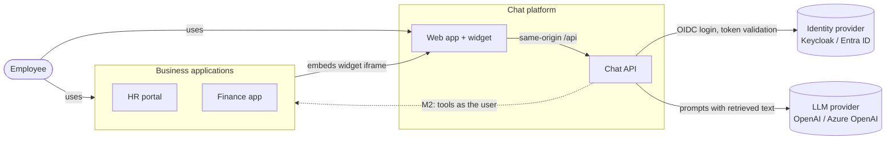
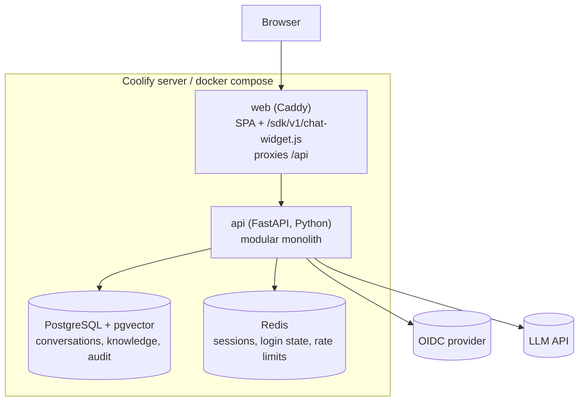
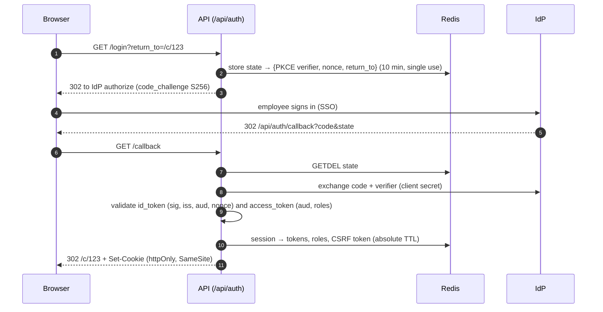
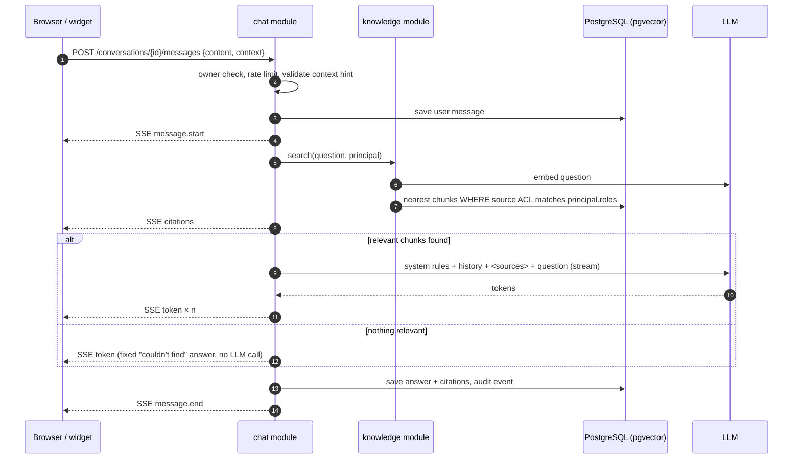
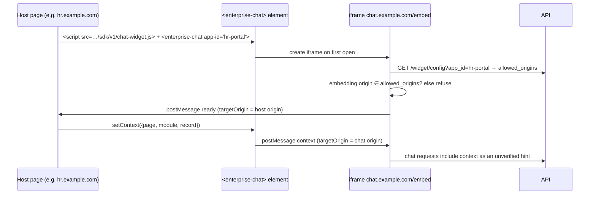

# Solution architecture

One centrally managed AI assistant that employees use either as a standalone web app or as a widget embedded in internal business applications. It answers from approved company knowledge with citations (milestone 1), and later calls live business APIs on the employee's behalf (milestones 2–3).

**Guiding rule:** the assistant never retrieves or reveals anything the signed-in employee is not allowed to see. Authorisation is enforced in code and in the database, never by the LLM prompt.

## Milestones

| Milestone | Scope | Status |
|---|---|---|
| **M1: Foundation + RAG** | SSO, chat UI with streaming, conversation history, embeddable widget, knowledge ingestion + permission-filtered retrieval, citations, audit log, admin page, Coolify deployment | **Implemented** |
| **M2: Agent + first live connector** | Application registry with tools, MCP connector, LangGraph agent (knowledge search becomes one tool), token exchange (user identity passed to apps), Finance sample app (invoice INV-1024), signed host context | Planned |
| **M3: Full platform** | REST connector (HR sample), cross-application routing, write actions with human approval, escalation/ticketing, admin onboarding portal, Playwright e2e | Planned |

## System context



## Containers (deployment units)



The browser only ever talks to one origin. The API is a **backend-for-frontend**: it runs the OIDC login, keeps tokens server-side in Redis and gives the browser an opaque, httpOnly session cookie.

## API modules (modular monolith)

Each module is a package under `services/api/app/modules/` with its own models, routes and services. Modules talk through plain Python function calls, not HTTP, which keeps the system simple until a module needs to scale on its own.

| Module | Responsibility | Key interfaces |
|---|---|---|
| `identity` | OIDC login (auth code + PKCE), Redis sessions, CSRF, JWT validation, `Principal` | `get_principal`, `require_admin` dependencies; `/api/auth/*` |
| `registry` | Known business applications and their allowed embedding origins. Grows into the capability registry in M2. | `/api/v1/applications`, `/api/v1/widget/config` |
| `conversations` | Conversations and messages, owner-only access | `/api/v1/conversations*` |
| `chat` | One chat turn: retrieve, prompt, stream, persist, audit | `POST /api/v1/conversations/{id}/messages` (SSE) |
| `knowledge` | Ingestion (Markdown/text/PDF → chunks → embeddings), ACL-filtered vector search | `search_knowledge()`, `/api/v1/admin/knowledge/*` |
| `llm` | Provider abstraction: `mock`, `openai`, `azure_openai` | `ChatModel.stream()`, `Embedder.embed_*()` |
| `audit` | Append-only audit trail | `record_audit()`, `/api/v1/admin/audit` |
| `core` | Config, DB, Redis, logging, problem+json errors, request ids, rate limiting | — |

M2 adds `connectors` (MCP + REST), `orchestrator` (LangGraph) and extends `registry` with tools; the chat route then calls the orchestrator instead of the fixed RAG pipeline.

## Key flows

### Sign-in (backend-for-frontend)



Tokens near expiry are refreshed on the next request and **roles are re-read**, so a role removed in the IdP stops working within one access-token lifetime (5 minutes by default).

### Chat turn (RAG, milestone 1)



### Widget handshake



The browser enforces the same rule with `Content-Security-Policy: frame-ancestors` on `/embed` (set by Caddy from `FRAME_ANCESTORS`).

## Data model

```mermaid
erDiagram
    users ||--o{ conversations : owns
    conversations ||--o{ messages : contains
    applications ||--o{ conversations : "origin (optional)"
    applications ||--o{ knowledge_sources : "owns (optional)"
    knowledge_sources ||--o{ documents : contains
    documents ||--o{ chunks : "split into"
    users { uuid id PK; text subject UK; text email; text display_name }
    applications { text id PK; text name; text[] allowed_origins; bool enabled }
    conversations { uuid id PK; uuid user_id FK; text title; text origin_app_id FK; timestamptz archived_at }
    messages { uuid id PK; bigint seq; uuid conversation_id FK; text role; text content; jsonb citations; jsonb meta }
    knowledge_sources { uuid id PK; text slug UK; text name; text application_id FK; text[] acl_roles }
    documents { uuid id PK; uuid source_id FK; text title; text checksum; int chunk_count }
    chunks { uuid id PK; uuid document_id FK; int ordinal; text heading; text content; vector embedding }
    audit_events { bigint id PK; timestamptz occurred_at; text action; text outcome; text actor_subject; jsonb details }
```

- `chunks.embedding` is `vector(1536)` with an HNSW index (cosine). Changing embedding model dimensions needs a migration.
- `knowledge_sources.acl_roles` empty = all authenticated employees; otherwise the employee needs at least one listed role.
- `audit_events` is append-only, enforced by a database trigger.

## Security controls (M1)

| Threat | Control |
|---|---|
| Unauthorised data in answers | ACL filter inside the vector SQL query; restricted chunks never reach the LLM. Tested in `tests/test_api.py`. |
| Token theft via XSS | Tokens never reach the browser; httpOnly session cookie; strict CSP; Markdown rendered without raw HTML. |
| CSRF | Per-session CSRF token required on cookie-authenticated writes; SameSite cookies; no CORS. |
| Login attacks | PKCE S256, single-use state, nonce check, open-redirect-safe `return_to`, session id rotated at login. |
| Stale privileges | Roles re-read on every token refresh; absolute session lifetime. |
| Prompt injection via documents | Retrieved text delimited and declared as data; tag-breaking sequences escaped; no tools in M1; images stripped from output (blocks exfiltration via image URLs). |
| Hallucinated policies | Answers must cite sources; deterministic fallback when nothing relevant is retrieved; low temperature. |
| Clickjacking / rogue embedding | `frame-ancestors` CSP plus an origin allow-list checked by the iframe; postMessage origin and source checks on both sides. |
| Abuse / cost | Per-user rate limit (Redis), message length limits, upload size and type limits. |
| Repudiation | Audit events for login, logout, chat turns (document ids, not content), admin changes; request ids in logs. |

## Milestone 2 preview: agent and live data

- **Integration contract (hybrid):** applications expose tools over **MCP** (Streamable HTTP) where they can; legacy apps are described by a declarative **REST manifest**. Both sit behind one `Connector` interface, so onboarding an app is registration, not a code change. See [decisions.md](decisions.md#adr-003-hybrid-mcp--rest-connectors).
- **Identity propagation:** the API exchanges the employee's token for one scoped to the target app (Keycloak token exchange / Entra On-Behalf-Of). The app enforces record-level rules itself, so the platform cannot be used to bypass them.
- **Orchestration:** a LangGraph graph (route → agent ⇄ tools → respond) with a checkpointer, so write actions can pause for human approval. Only tools the employee is entitled to are shown to the model.
- **Signed host context:** host apps sign a short-lived context token (JWT) instead of sending plain hints, so "the invoice on screen" becomes trustworthy input.
